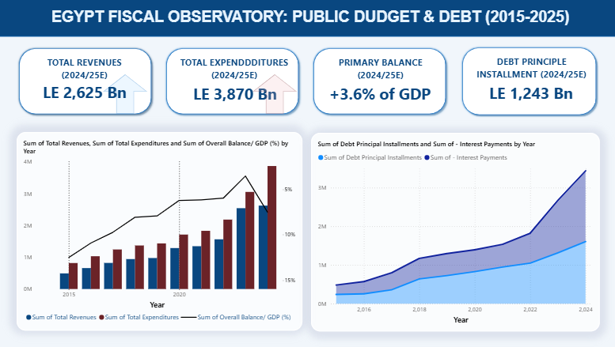

# Public Budget Analysis (2015–2025)
An interactive Power BI dashboard designed to explore public budget trends and fiscal developments over the 2015–2025 period in Egypt.

  
  

## Project Overview

This project applies Business Intelligence techniques to public finance data, transforming budget information into interactive visualizations that facilitate financial analysis and support data-driven interpretation.

## Objectives

- Examine public budget trends over time.
- Monitor changes in budget allocations and expenditure.
- Identify patterns in public financial developments.
- Present fiscal information through interactive visualizations.

## Tools & Technologies

- Microsoft Power BI
- Power Query
- DAX
- Data Visualization

## Dashboard Preview

## Project Files

- `.pbix` — Interactive Power BI dashboard.
- `Assets/` — Dashboard screenshots and visual outputs.

## Author
Sama Farouk  
International Economics | Quantitative Analysis | Economist
